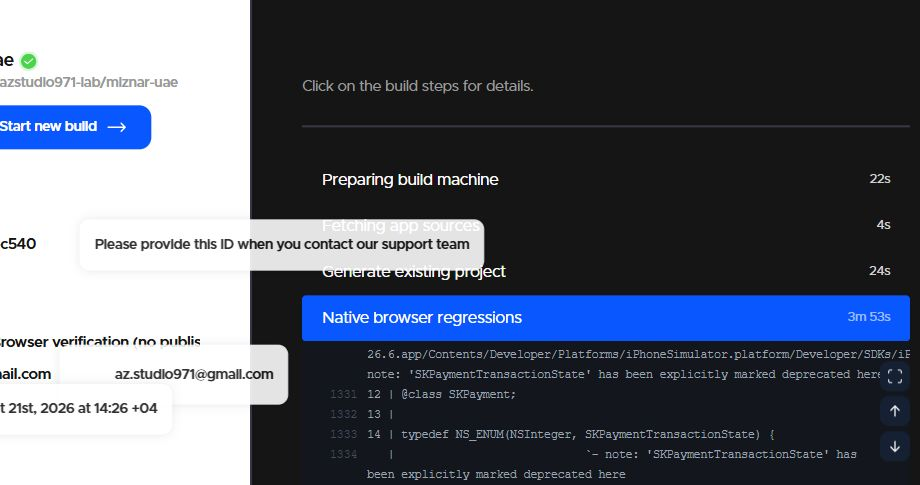
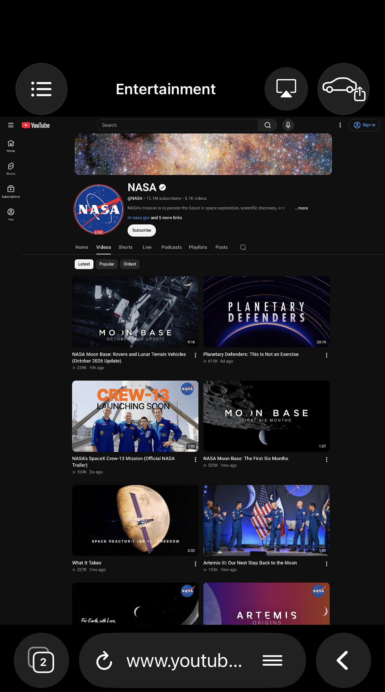
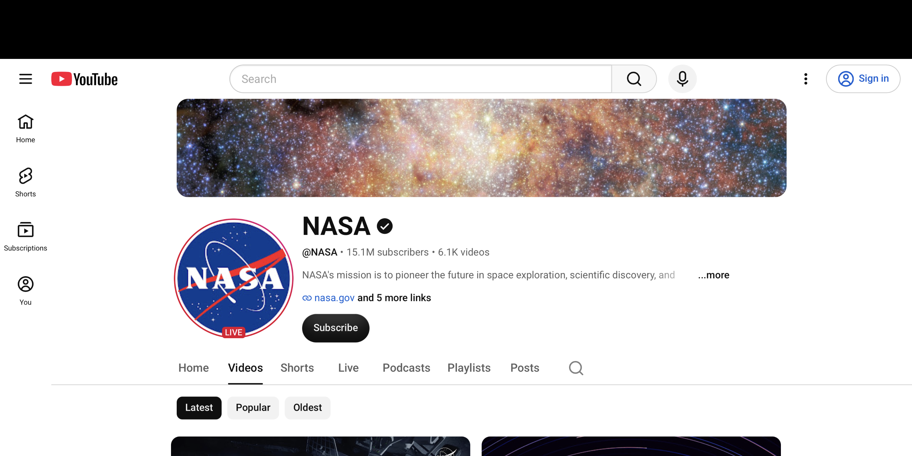
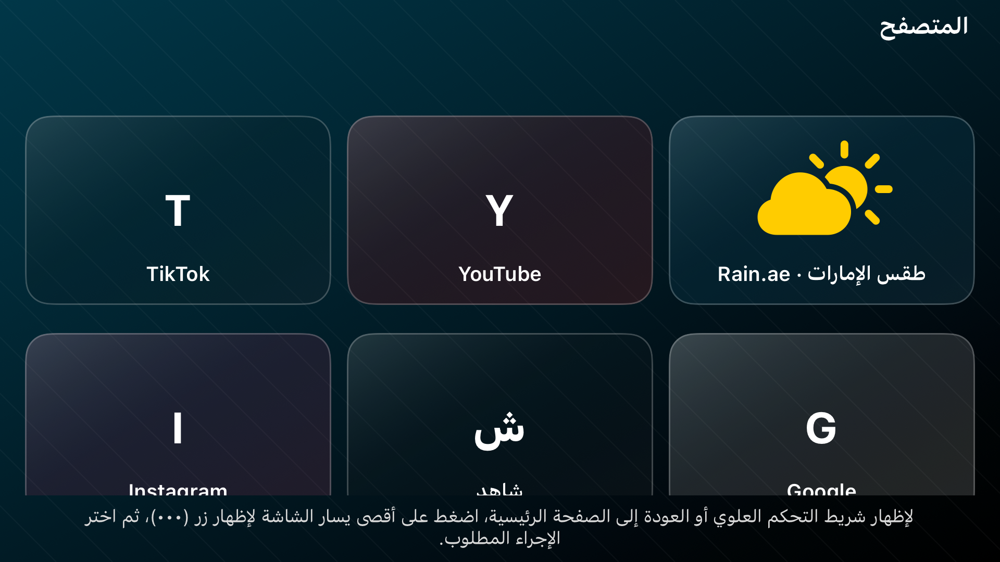

# WudCar 1.6.0 — سجل التنفيذ والتحقق

فرع التطوير: `develop/wudcar-1.6.0`، مبني على آخر مصدر 1.5.0 (`e8cd212`). لم يُدمج في الإنتاج ولم يُرفع 1.6.0 إلى TestFlight. الإصدار التسويقي 1.6.0 والبناء المستهدف 16؛ آخر بناء ظاهر في App Store Connect أثناء العمل 15. مسار التوقيع يعيد التحقق ويختار رقماً أعلى عند الحاجة، مع الحفاظ على Bundle ID `com.azstudio.wudcar`.

## الأسباب والتغييرات

| الطلب | التشخيص والتغيير | حدود الإثبات |
| --- | --- | --- |
| إظهار (…) بوسيلة غير لمسية | ريموت الهاتف القديم حصر المؤشر داخل محتوى الويب، مع هامش يمنع الوصول للحافة، وأرسل النقر إلى DOM دون فحص أزرار UIKit. أصبح موضعه ضمن إحداثيات الشاشة الكاملة، وتُفحص عناصر المتصفح الأصلية أولاً. منطقة الزاوية زر UIKit بمساحة 44×44، ومعها حافة إضافية بعرض 12 نقطة على طول اليسار عند إخفاء الشريط، وتستجيب لإجراء التفعيل الأساسي الرسمي. | إصلاح مسار الريموت الحالي لا يثبت أن كل سيارة ترسل أحداث ماوس إلى نافذة مخصصة. اختبار جهاز تحكم CarPlay فعلي ما زال مطلوباً. |
| إلغاء القائمة | سبب القائمة هو `UIMenu` و`showsMenuAsPrimaryAction`. أُزيلت القائمة؛ التفعيل يفتح الشريط مباشرة مع بقاء الرئيسية ضمنه ومؤقت الإخفاء ست ثوانٍ. | يُختبر تفعيل الزر الأصلي ومسار التحكم في التطبيق؛ هذه ليست محاكاة دليل مادي على ريموت السيارة. |
| تخطيط سطح المكتب و100% | الطلب السابق كان يستخدم UA و`.desktop` بالفعل. الصور تبين عناصر YouTube المكتبية الكبيرة، بما يتفق مع نافذة تخطيط ضيقة، لا تثبت أن الوثيقة هي واجهة الهاتف. التنفيذ المستقل الجديد يجعل نافذة WebKit المنطقية 1280 نقطة على الأقل، ويلائم UIView تناسبياً مع المساحة الفعلية بواسطة `bounds/center/transform` العامة. يبقى `pageZoom=1` مستقلاً تماماً. أثبت اختبار YouTube المباشر أن استجابة سطح المكتب لا تحتوي meta viewport، فاختار WebKit عرضه الافتراضي القديم 980 رغم عرض UIView المنطقي 1280. أُضيف WKUserScript محدود إلى YouTube فقط يضيف meta viewport قياسياً إذا كان غائباً، وعند استخدام UA المكتبي فقط. لا يُعدل أي viewport موجود أو CSS الموقع، ولا يُطبّق هذا الاستكمال على المواقع الأخرى. تُحدّث الأبعاد عند تغيير الاتجاه أو حجم الشاشة. | الاختبار يقيس `innerWidth` وCSS breakpoints بعد اكتمال التحميل وتغيير المقاس. نجاح الصفحة المحلية وحده لا يثبت YouTube؛ له اختبار شبكة مستقل داخل مكوّن المتصفح الفعلي. |
| تحليل CARTV | الملف IPA، التطبيق CarTV 1.1.3 (48)، الحد الأدنى iOS 18، ويعلن أدوار الهاتف وCarPlay والشاشة الخارجية والتوصيل غير التفاعلي. الملف التنفيذي يحتوي `cryptid=1`؛ لم يُفك تشفيره. المورد HTML المقروء هو صفحة الخصوصية؛ لا توجد حزمة JS مستقلة للمتصفح. | لا يمكن استنتاج UA أو خوارزمية الملاءمة الداخلية أو قبول Apple من البيانات المتاحة. الصور مرجع للكثافة البصرية وصغر الشريط، والتنفيذ مستقل. |
| تصغير الشريط | ارتفاع شريط السيارة من 34 إلى 20 نقطة، أي أصغر بنحو 41%؛ الخط والرموز أصغر، ورأس الهاتف أصبح أقل ارتفاعاً بخط 15 وسطر واحد مع بقاء أهداف اللمس44، مع عرض ضغط 44 نقطة للأزرار وامتداد منطقة الضغط رأسياً إلى 44 أثناء ظهور الشريط المؤقت. | امتداد اللمس الشفاف يصل 24 نقطة أسفل الرسوم أثناء ظهور الشريط؛ يزول عند إخفائه. المحتوى المرئي يبدأ بعد الشريط. يلزم تقييم قابلية الاستخدام على السيارة. |
| عنوان المتصفح | الخط من 24 إلى 15 نقطة، والمسافة إلى البطاقات من 6 إلى 3، دون إعادة تصميم البطاقات أو تعديل الاختصارات. | صور اختبار الشبكة بالأحجام الثلاثة توثق النتيجة. |

## التكبير والترقية

الإعداد الافتراضي الجديد 100%. تُرحّل قيمة 50% القديمة إلى 100% مرة واحدة، لأن الإصدار السابق لا يسجل هل كانت 50% اختياراً يدوياً أم الافتراضي. القيم القديمة الأخرى تُحفظ. بعد الترقية تُحفظ الاختيارات اليدوية، بما فيها 50% إن اختارها المستخدم من جديد؛ لا يعيد التحميل ضبطها. الهاتف يبدأ بـ100% مع بقاء وظائف التكبير الحالية. الملاءمة البصرية ليست تغييراً لقيمة التكبير.

## شرط الاعتماد

وفق آخر توجيه للمستخدم: يجب إثبات عمل YouTube بسطح المكتب في الهاتف وCarPlay معاً قبل اعتماد النسخة. نجاح الهاتف وحده أو محاكاة أبعاد السيارة لا يكفيان، ولن يُطلب اعتماد الإصدار أو رفعه قبل تحقق الشرطين.

## نتائج التحقق

- نجح بناء iOS والاختبارات الأصلية العشرة دون فشل أو تخطٍ في [GitHub Actions](https://github.com/azstudio971-lab/miznar-uae/actions/runs/39582922048)، للمصدر `e3b57d4`؛ زمن الاختبارات الفعلية81 ثانية بعد إقلاع المحاكي.
- نجح مسار [Codemagic النهائي كاملاً](https://codemagic.io/app/6ad1db1b951fcdf1e4f45860/build/6ad89304454d2506f7abc540) بالحالة `finished`، للمصدر `dc43232`، خلال4د50ث. اجتازت الاختبارات العشرة وتصدير الصور بنجاح. هذا مسار محاكي مستقل لا يبني IPA ولا يرفع TestFlight. كُشف تكرار في تصدير الصور في تشغيل سابق بعد نجاح الاختبارات، وأزيل قبل التشغيل النهائي الناجح.
- نجحت اختبارات الويب السبعة وبناء الويب واختبارات الواجهة على GitHub. هذه مستقلة عن إثبات متصفح iOS.
- الهاتف داخل المحاكي: YouTube `ytd-app=true` و`ytm-app=false`، و`innerWidth=1280` و`pageZoom=1`، مع نتائج بحث حقيقية. ظل التخطيط ثابتاً بعد فتح قناة NASA والرجوع، مع اشتراط خمس ثوانٍ متصلة من اكتمال الصفحة وثبات سطح المكتب لكل مرحلة.
- واجهة السيارة داخل المحاكي: النتائج نفسها، وعرض1280 بعد التنقل والرجوع وتكبير100%. **تمت استضافة CarBrowserViewController داخل محاكي iPhone بأبعاد سيارة؛ لم يُستخدم CarPlay Simulator أو جهاز CarPlay فعلي.**
- نجحت اختبارات مساحة CSS في أبعاد تمثل رأسي/أفقي الهاتف وثلاثة مقاسات سيارة، وامتلاء الحاوية الأصلية، وثلاثة أعمدة في الصفحة المحلية، والتمرير والتنقل، وهندسة ملء شاشة الفيديو والخروج منه. اختبار هندسة عنصر الفيديو لا يثبت تشغيل بث حقيقي.
- نجح اختبار إكمال viewport الناقص في YouTube، واحترام viewport الموجود، وعدم تعديل موقع آخر. نجحت ترقية100% مرة واحدة مع حفظ التغيير اليدوي، وتفعيل حافة اليسار ثم (…) دون قائمة، وارتفاع الشريط20 وخط العنوان15.
- نجحت اختبارات الحفاظ على بيانات الاختصارات القديمة وصور المناسبة وفشلها، ولقطات شبكة الاختصارات بثلاثة مقاسات.
- اختبار iPhone المادي وCarPlay باللمس وغير اللمس: **غير متاح من بيئة العمل الحالية ولم يُثبت نجاحه. الإصدار غير معتمد.**
- مسارا Codemagic الخاصان بتجهيز IPA لـTestFlight يتوقفان إذا لم ينجح اختبار YouTube أو كانت سجلات إثبات الهاتف وCarPlay غير مكتملة. `Config/BrowserAcceptance160.json` ما زال يسجل الحالتين غير موثقتين. جرى اختبار رفض مسار الرفع حتى مع سجل محاكي ناجح عند غياب الإثباتين. لم يُشغّل أي مسار يرفع1.6.0.

أول تجربة YouTube فشلت في شرط العرض المستهدف بسبب viewport الافتراضي980؛ لا يعني هذا وحده أن الوثيقة كانت واجهة هاتف. القياسات أظهرت وثيقة desktop مع غياب meta viewport، ثم أثبتت إعادة الاختبار عرض1280 بعد المعالجة المحددة. سجل القياسات الأصلي: [RESULTS.txt](verification/160/RESULTS.txt).

## الصور الأصلية من الاختبار

هذه صور ناتجة عن تشغيل الكود على المحاكي، ولم تُعدل. صور CARTV المرجعية للصفحة الرئيسية، وصور التحقق لقناة عامة متاحة دون حساب؛ يحدد YouTube عدد الأعمدة بحسب الصفحة والمساحة، ولا يُفرض عدد موحد في الكود.

الصورة الثانية تتضمن حواف الأمان الخاصة بنافذة محاكي الهاتف؛ لا تثبت مساحة العرض أو الإدخال على سيارة فعلية.

بقية الصور ونتيجة XCTest الكاملة في مرفقات تشغيل GitHub المرتبط أعلاه.

## حدود Apple والبديل الرسمي

واجهات UIKit/WebKit المستخدمة عامة. لكن سماح UIKit بعرض نافذة لا يثبت أن السيارة تتيح إدخالاً تفاعلياً إليها، ولا يضمن السماح بمتصفح عام ضمن CarPlay. وثائق Apple تجعل القوالب هي المسار الذي يدير تباين الأجهزة وأدوات الإدخال، وتشغيل الفيديو مرتبط بالسيارات المدعومة وحالة الوقوف. عند اتصال شاشة خارجية غير تفاعلية لا يمكن اختراع أحداث ماوس من السيارة بواجهة رسمية. البديل الموجود في المشروع: واجهة CarPlay بالقوالب لوسائل التحكم المتاحة، مع فتح الموقع والتحكم على iPhone وإرسال الفيديو عبر AirPlay حيث يدعمه الموقع والسيارة. لم تُضف محاكاة UITouch أو Private API أو تجاوز DRM، ولم تُنسخ شيفرة CARTV.

المراجع الرسمية التي روجعت:
- https://developer.apple.com/videos/play/wwdc2026/212/
- https://developer.apple.com/documentation/webkit/wkwebpagepreferences/preferredcontentmode
- https://developer.apple.com/documentation/webkit/wkwebview/pagezoom
- https://developer.apple.com/documentation/uikit/uiview/transform

الاشتراكات وM3U وXtream والشعار وبيانات المستخدم وإعدادات التوقيع الأساسية لم تدخل في نطاق تغييرات 1.6.0.

- مرجع سبب عرض 980 الافتراضي: https://developer.apple.com/library/archive/documentation/AppleApplications/Reference/SafariWebContent/UsingtheViewport/UsingtheViewport.html

## Authorized internal TestFlight test

The owner explicitly requested a TestFlight upload for personal testing on 2026-10-21. Only the manual `wudcar-device-validation` workflow may use `--internal-testflight` after the live simulator YouTube probe passes. Both physical-device acceptance records remain false. Production release retains its original gate and is not authorized. No App Store submission or production merge is included.
