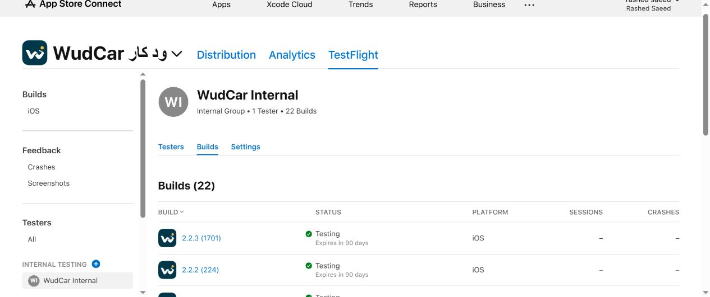

# WudCar 17 TEST-AUDIO — 2.2.3 (1701)

## Completed internal TestFlight build

- Built source: `2bd46f623f78bf285ec11e99bd6e1cb379861e15`, derived from required base `6ca24bc877495dbaed55ff2aa833e687fa4e058f`.
- Branch: `test/wudcar-17-test-audio`. No merge to production.
- Codemagic: https://codemagic.io/app/6ad1db1b951fcdf1e4f45860/build/6adb3d321371b66e82e9ec27
- Version/build: **2.2.3 (1701)**. Build 1701 was available; the previous highest TestFlight build was 224.
- Debug build, all 11 selected Codemagic native tests, Release archive, and signed-entitlement gate succeeded. Earlier GitHub validation passed 16 native tests and web checks on the identical app code.
- Signed app: `com.apple.developer.carplay-audio=true`; `com.apple.developer.carplay-video` absent. Actual codesign output is recorded verbatim in [signed-entitlements.txt](signed-entitlements.txt).
- Required warning printed by the passing gate: `WARNING: provisioning profile still allows CarPlay Video (App ID capability). Signed app entitlements are audio-only.`
- Owner explicitly authorized this profile-only warning. Signed-app Audio=true and Video absence remain mandatory build-stopping requirements; profile Audio=true also remains required.
- Apple upload succeeded with no errors. Delivery/build UUID: `741a82b2-5f29-462b-bbcc-fc632e57cbc0`.
- App Store Connect visibly confirms **WudCar Internal → 2.2.3 (1701) → Testing**, 90-day expiry.
- Build Test Information confirms **Group (1): WudCar Internal, Internal, 1 tester**, no individual testers, and **What to Test blank (4,000 characters remaining)**.
- No external TestFlight group or App Store review submission.
- No changes to app/browser code, App ID settings, certificates, account, or existing app identity in this follow-up. The baseline signed application identifier remains `QS29RVJPUT.com.azstudio.wudcar`.
- Browser remains the first Favorites item on CarPlay using build 17 startCarScreen(). Physical vehicle/browser behavior remains unverified and will be tested by the owner.

## Previous blocked attempt

The first attempt at https://codemagic.io/app/6ad1db1b951fcdf1e4f45860/build/6adb38451371b66e82e9ea82 built the same app code but stopped on profile Video presence before upload. The owner then authorized changing that profile-only check to a warning. The signed application entitlements remained audio-only in both attempts.
