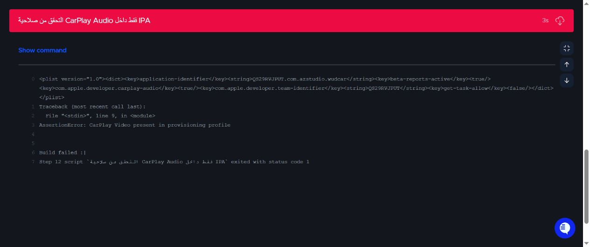

# WudCar 17 TEST-AUDIO — build 1701

- Built source: `7331a76a321adc969bdb0db37f299560b34f5222`, derived from required base `6ca24bc877495dbaed55ff2aa833e687fa4e058f`.
- Codemagic: https://codemagic.io/app/6ad1db1b951fcdf1e4f45860/build/6adb38451371b66e82e9ea82
- Version/build: 2.2.3 (1701). Codemagic queried latest TestFlight build 224 before choosing 1701.
- GitHub validation: 16 native tests passed plus web checks.
- Codemagic: Debug simulator build succeeded; all 11 selected tests passed; Release IPA archive succeeded.
- Signed app entitlements are recorded verbatim from `codesign -d --entitlements :-` in signed-entitlements.txt. CarPlay Audio=true; CarPlay Video absent.
- Blocking verification result: `AssertionError: CarPlay Video present in provisioning profile`.
- Pipeline failed closed before external publication. Publishing output explicitly states `Not publishing to external services`. The IPA is an artifact only and was NOT uploaded to App Store Connect/TestFlight.
- No App Store review submission and no What to Test changes.
- Browser remains the first item under the Favorites CarPlay template, using the build 17 startCarScreen() mechanism. Real vehicle/browser behavior remains unverified.
- Owner-authorized follow-up: profile CarPlay Video presence is warning-only; the signed app must still contain CarPlay Audio=true and no CarPlay Video. No App ID capability, identity, app or browser changes.
- Required warning: `WARNING: provisioning profile still allows CarPlay Video (App ID capability). Signed app entitlements are audio-only.`
- Rebuild 2.2.3 (1701), or the first available higher build, for WudCar Internal only. No What to Test or App Store review submission.

